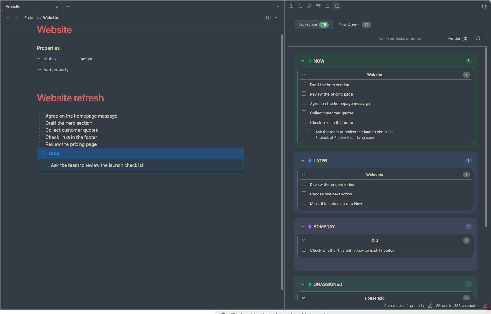
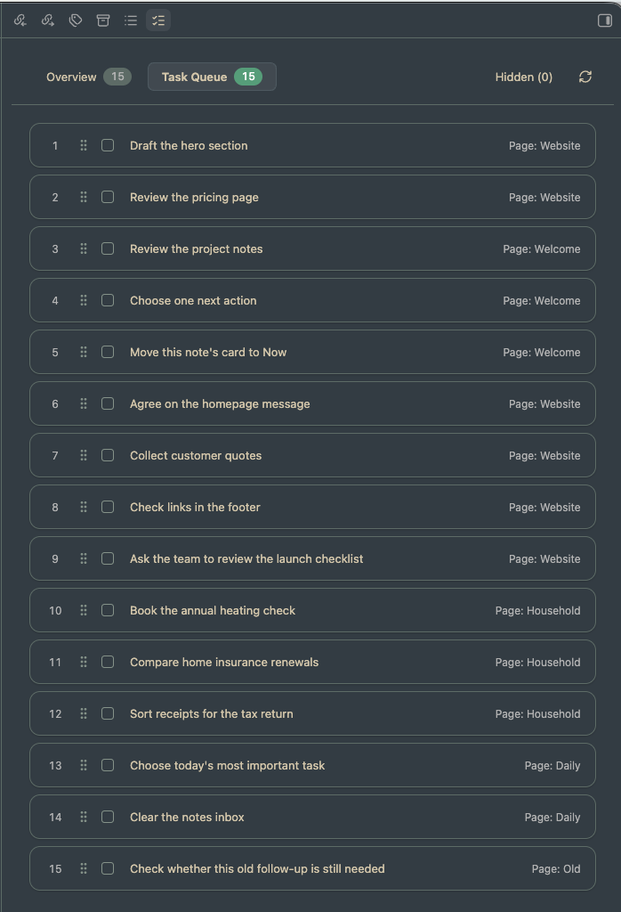

# Wheelhouse Task View

**Your notes are your projects. Your checkboxes are your tasks.**

Wheelhouse Task View brings open Markdown checkboxes from across your Obsidian vault into one simple board. Group work by note, move a whole note between **Now**, **Later**, **Someday**, and **Unassigned**, or keep a separate list of tasks in the order you choose.

No new task syntax. No project database. No runtime dependencies. Your notes stay the source of truth.





## A simple way to see your work

- **One card per note.** Every open task in a note stays together. Moving the card changes the lane for the whole note.
- **Four clear lanes.** Sort notes into Now, Later, Someday, or leave them Unassigned. Lane colors are customizable.
- **A personal task queue.** Keep individual tasks in a manual order, independent of the board. New tasks can be added to the end automatically.
- **Work from the source.** Open a task to jump to its note. Complete it in the board or queue and its Markdown checkbox is checked in the note.
- **Find things quickly.** Filter by task or note name, collapse cards and lanes, and hide cards you do not want on the board. Notes with duplicate filenames show their parent folder for clarity.

Wheelhouse Task View does not assign priorities, schedule work, create project files, or change task text. It adds a small amount of local organization around the Markdown you already write.

## Get started

Write ordinary open checkboxes in any Markdown note:

```md
# Website refresh

- [ ] Draft the new homepage
- [ ] Gather customer quotes
- [ ] Review the launch checklist
```

Open **Wheelhouse Task View** from the ribbon or command palette. The note appears as one card with its tasks. Move the card to a lane when you want to organize the project; all tasks in that note move together. Use the Task Queue when you want to order specific next actions across notes.

Recognized task markers are `- [ ]`, `* [ ]`, and `+ [ ]`. Completed checkboxes are not shown. Tasks inside fenced code blocks are ignored.

## Install

Wheelhouse Task View is not yet published in Obsidian’s Community Plugins directory. To install it manually:

1. Get `main.js`, `manifest.json`, and `styles.css` from a release or this repository.
2. Copy them into `<your-vault>/.obsidian/plugins/wheelhouse-task-view/`.
3. In Obsidian, reload community plugins and enable **Wheelhouse Task View**.

When upgrading from the earlier `task-overview` ID, disable the old plugin first. Wheelhouse Task View copies saved settings and task organization into its new data folder on first launch; the old data file is left in place.

## Settings

Configure excluded folders or files, optional `.txt` scanning, lane colors, and whether newly discovered tasks join the end of the queue. Restore hidden tasks, rescan the vault, or clean up stale task metadata from the plugin settings.

## Your notes stay yours

Markdown remains the source of truth. Task text is never copied into plugin data. The plugin stores task fingerprints and local organization data—such as note lanes, queue order, hidden state, and settings—in the vault’s `.obsidian/plugins/wheelhouse-task-view/data.json` file.

There are no accounts, network requests, telemetry, databases, or runtime dependencies.

## Limits

- Numbered checkboxes such as `1. [ ]` are not recognized.
- Task text is shown as plain text; Markdown links and formatting are not rendered in the board.
- Task identity is matched using local fingerprints. Ambiguous edits can cause a task to lose its previous lane or queue position rather than inherit the wrong one.
- Very large vaults take longer to scan. Unchanged files are skipped on later scans.

## Development

The plugin has no npm dependencies. Source modules are in `src/`; `scripts/build.js` bundles them into Obsidian’s single-file `main.js` using Node built-ins.

```bash
node scripts/build.js
node --test test/
scripts/install-dev.sh
```

Open `dev-vault/` as an Obsidian vault to explore the sample notes and tasks.
