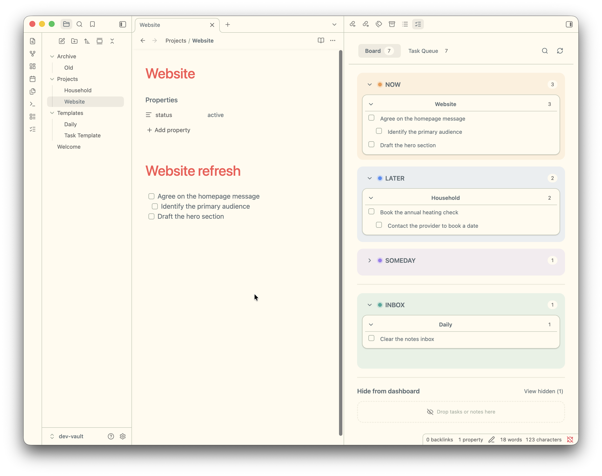
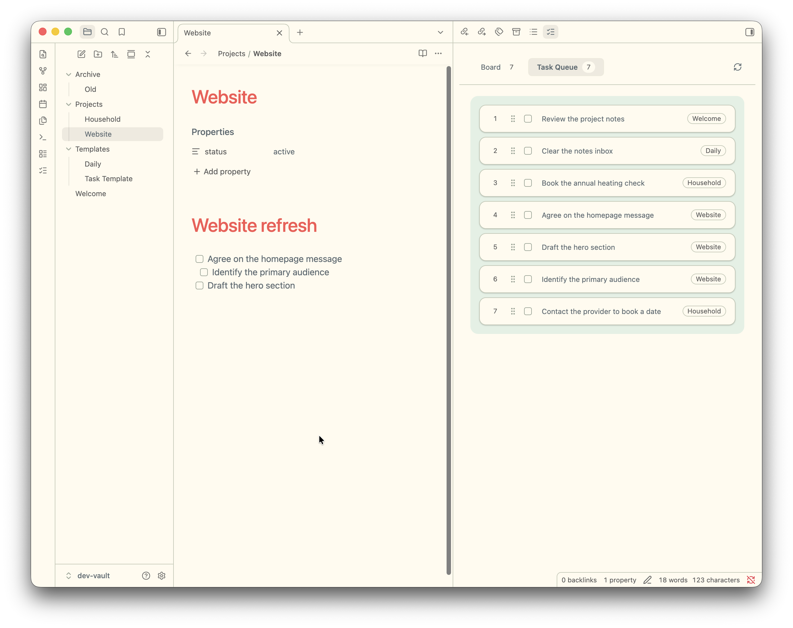

# Wheelhouse Task View

**Your notes are your projects. Your checkboxes are your tasks.**

Wheelhouse Task View brings open Markdown checkboxes from across your Obsidian vault into one simple board. Group work by note, move a whole note between **Now**, **Later**, **Someday**, and **Inbox**, or keep a separate list of tasks in the order you choose.

No new task syntax. No project database. No runtime dependencies. Your notes stay the source of truth.

| Board · light theme | Task Queue · light theme |
| --- | --- |
|  |  |

| Board · dark theme | Task Queue · dark theme |
| --- | --- |
|  |  |

## A simple way to see your work

- **One card per note.** Open tasks from each note stay together. Drag a card to move all of that note’s tasks between Now, Later, Someday, and Inbox.
- **A separate task queue.** Add individual tasks from the “Not in queue” list, then drag them into your preferred order. New tasks join the end automatically by default; this can be turned off in settings.
- **Work from the source.** Open a task to jump to its note. Completing it in the board or queue checks the original Markdown checkbox.
- **Find and focus.** Search task text and note paths, collapse lanes or note cards, and drag tasks or whole notes into “Hide from dashboard.” Hidden tasks can be restored later. Duplicate note names include enough parent folders to distinguish them.
- **Make it yours.** Rename the board sections and choose their colors, along with the task queue background color.

Wheelhouse Task View does not assign priorities, schedule work, create project files, rewrite task wording, or add task syntax. It adds local organization around the Markdown you already write. Completing a task checks its existing checkbox in the note.

## Get started

Write ordinary open checkboxes in any Markdown note:

```md
# Website refresh

- [ ] Draft the new homepage
- [ ] Gather customer quotes
- [ ] Review the launch checklist
```

Open **Wheelhouse Task View** from the ribbon or command palette. The note appears as one card in Inbox. Move the card to a board section to organize it; all its open tasks move together. Use the Task Queue to order individual tasks across notes.

The plugin recognizes non-empty, open checkboxes written with `- [ ]`, `* [ ]`, or `+ [ ]`. Nested checkboxes are supported. Completed tasks, checkboxes in YAML front matter, and checkboxes inside fenced code blocks are not shown. Markdown files are scanned by default; `.txt` scanning is optional.

## Install

Wheelhouse Task View is not yet published in Obsidian’s Community Plugins directory. To install it manually:

1. Get `main.js`, `manifest.json`, and `styles.css` from a release or this repository.
2. Copy them into `<your-vault>/<config-folder>/plugins/wheelhouse-task-view/`. The default config folder is `.obsidian`; vaults with a custom config folder should use that folder instead.
3. In Obsidian, reload community plugins and enable **Wheelhouse Task View**.

When upgrading from the earlier `task-overview` ID, disable the old plugin first. On first launch, Wheelhouse Task View tries to copy the old data file at `.obsidian/plugins/task-overview/data.json` into its new plugin data store. The old file is left in place.

## Settings

In plugin settings, exclude folders or files from scanning, enable optional `.txt` scanning, set colors for the board sections and queue, and choose whether new tasks are added to the queue automatically. Restore hidden tasks, rescan the vault, or remove saved metadata for missing tasks.

## Your notes stay yours

Markdown remains the source of truth. The plugin stores task fingerprints, note paths, lane assignments, queue order, hidden state, and settings through Obsidian’s plugin data API. By default, this data is in `.obsidian/plugins/wheelhouse-task-view/data.json`; a custom vault config folder changes that location. Task wording stays in the notes.

There are no accounts, network requests, telemetry, databases, or runtime dependencies.

## Limits

- Numbered checkboxes such as `1. [ ]` are not recognized; use `- [ ]`, `* [ ]`, or `+ [ ]`.
- Task text is displayed as plain text. Markdown links are reduced to their visible label or target, and text formatting is not rendered.
- Task identity is matched using local fingerprints. Ambiguous edits can cause a task to lose its previous lane or queue position rather than inherit the wrong one.
- Very large vaults take longer to scan. Unchanged files are skipped on later scans.

## Development

The plugin has no npm dependencies. Source modules are in `src/`; `scripts/build.js` bundles them into Obsidian’s single-file `main.js` using Node built-ins.

```bash
node scripts/build.js
node --test test/
scripts/install-dev.sh
```

Open `dev-vault/` as an Obsidian vault to explore the sample notes and tasks.

## Releasing

Update the version in `manifest.json`, add its minimum version to `versions.json`, update `CHANGELOG.md`, and rebuild with `node scripts/build.js`. Commit and push those changes to `main`. Then run the release script:

```bash
node scripts/release.js --dry-run
node scripts/release.js
```

The script verifies that the working tree is clean, `main` matches `origin/main`, the manifest and changelog agree, the build is current, and the tag is unused. It then creates and pushes the annotated tag matching the manifest version. GitHub Actions builds and verifies `main.js`, attaches `main.js`, `manifest.json`, and `styles.css` with build provenance, and creates a draft release. Review the draft and generated notes on GitHub, then publish it. GitHub Actions must be enabled, with workflow permissions that allow creating releases.
