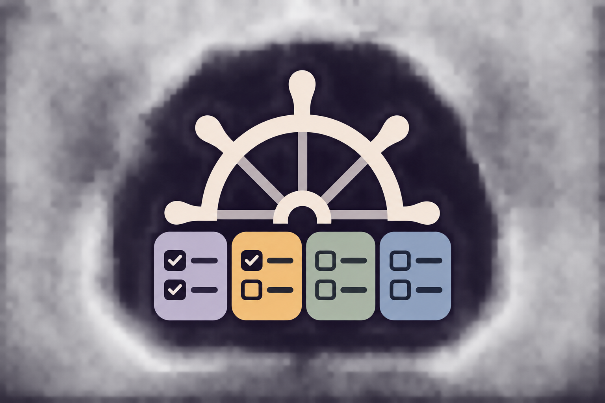
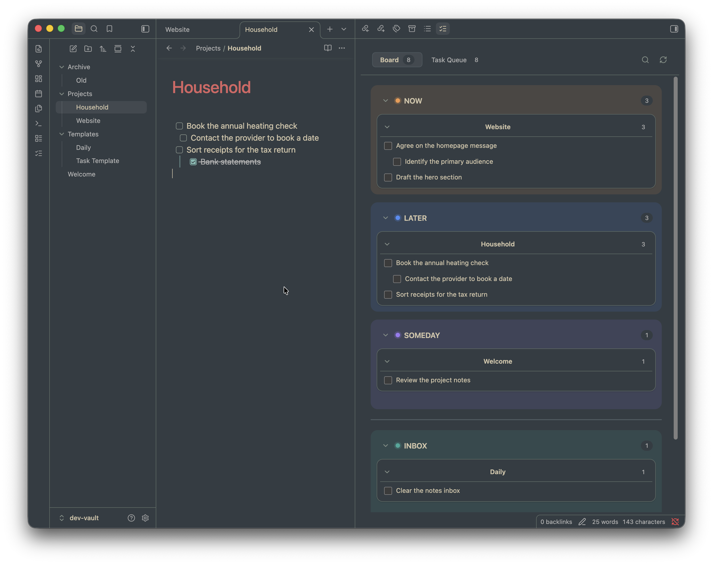
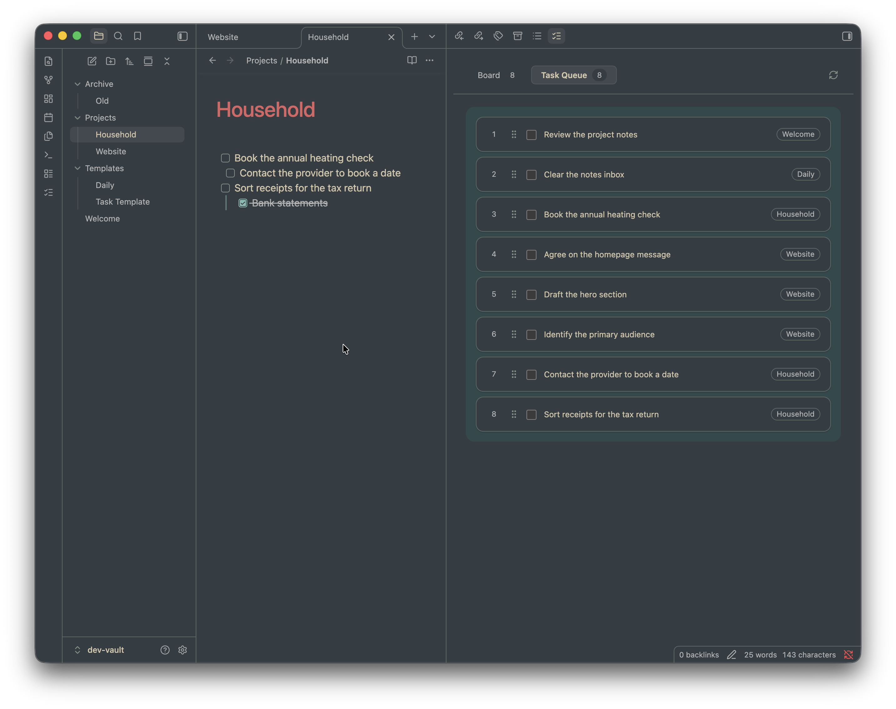

<p align="center">
  
</p>

<h1 align="center">Wheelhouse Task View</h1>

<p align="center"><strong>Your notes are your projects. Your checkboxes are your tasks.</strong></p>

<p align="center">
  <a href="https://community.obsidian.md/plugins/wheelhouse-task-view">Install from Obsidian Community Plugins</a>
  ·
  <a href="https://github.com/methun-mohan/wheelhouse-task-view/releases">GitHub releases</a>
</p>

Wheelhouse Task View brings open Markdown checkboxes from across your vault into a board organized by note. Move whole notes between **Now**, **Later**, **Someday**, and **Inbox**, or arrange individual tasks in a separate queue. Your Markdown remains the source of truth.

| Board · light theme | Task Queue · light theme |
| --- | --- |
|  |  |

| Board · dark theme | Task Queue · dark theme |
| --- | --- |
|  |  |

## Features

- **One card per note:** keep a note’s open tasks together and move the whole card between board lanes.
- **A separate task queue:** add tasks from any note and drag them into your preferred order.
- **Work from the source:** open a task’s note or complete it directly from the board or queue; the original Markdown checkbox is updated.
- **Search and focus:** search task text and note paths, collapse lanes and note cards, or hide tasks from the board and restore them later.
- **Make it yours:** rename the board lanes and choose their colors and the task queue background color.
- **Local by design:** no accounts, network requests, telemetry, databases, or runtime dependencies.

## Get started

Write ordinary open checkboxes in any Markdown note:

```md
# Website refresh

- [ ] Draft the new homepage
- [ ] Gather customer quotes
- [ ] Review the launch checklist
```

Open **Wheelhouse Task View** from the ribbon or command palette. The note appears as a card in **Inbox**. Move the card to **Now**, **Later**, or **Someday** to organize its tasks. Open **Task Queue** to order individual tasks across notes.

The plugin recognizes non-empty open checkboxes written with `- [ ]`, `* [ ]`, or `+ [ ]`, including nested checkboxes. It ignores completed checkboxes, checkboxes in YAML front matter, and checkboxes inside fenced code blocks. Markdown files are scanned by default; optional `.txt` scanning can be enabled in settings.

## Install

### Obsidian Community Plugins

In Obsidian, open **Settings → Community plugins → Browse**, search for **Wheelhouse Task View**, then select **Install** and **Enable**. You can also [open the plugin’s Community directory listing](https://community.obsidian.md/plugins/wheelhouse-task-view).

### Manual installation

Download `main.js`, `manifest.json`, and `styles.css` from the [latest GitHub release](https://github.com/methun-mohan/wheelhouse-task-view/releases/latest). Copy them into `<your-vault>/<config-folder>/plugins/wheelhouse-task-view/`. The default config folder is `.obsidian`; use your vault’s custom config folder if you have changed it. Reload community plugins and enable **Wheelhouse Task View**.

When upgrading from the earlier plugin ID `task-overview`, disable that plugin first. On first launch, Wheelhouse Task View tries to copy its data from `.obsidian/plugins/task-overview/data.json` into the new plugin data store. The old file is left in place.

## Settings and saved data

Settings let you exclude folders or files from scanning, enable `.txt` scanning, customize lane and queue colors, choose whether new tasks join the queue automatically, restore hidden tasks, rescan the vault, and remove saved metadata for missing tasks.

The plugin stores task fingerprints, note paths, lane assignments, queue order, hidden state, and settings through Obsidian’s plugin data API. By default, this is `.obsidian/plugins/wheelhouse-task-view/data.json`; vaults with a custom config folder store it there instead. Task wording stays in your notes.

## Limits

- Numbered checkboxes such as `1. [ ]` are not recognized; use `- [ ]`, `* [ ]`, or `+ [ ]`.
- Task text is shown as plain text. Markdown links are reduced to their visible label or target, and text formatting is not rendered.
- Task identity is matched using local fingerprints. Ambiguous edits can cause a task to lose its previous lane or queue position rather than inherit the wrong one.
- Very large vaults take longer to scan, though unchanged files are skipped on later scans.

## Development

The plugin has no npm dependencies. Source modules are in `src/`; `scripts/build.js` bundles them into Obsidian’s single-file `main.js` using Node built-ins.

```bash
node scripts/build.js
node --test test/
scripts/install-dev.sh
```

Open `dev-vault/` as an Obsidian vault to explore the sample notes and tasks.

## Releasing

Update the version in `manifest.json`, add its minimum supported Obsidian version to `versions.json`, update `CHANGELOG.md`, and rebuild with `node scripts/build.js`. Commit and push those changes to `main`, then run:

```bash
node scripts/release.js --dry-run
node scripts/release.js
```

The release script checks the working tree, branch, manifest, changelog, build, and tag before pushing an annotated version tag. GitHub Actions builds and verifies the plugin, attaches `main.js`, `manifest.json`, and `styles.css` with build provenance, and creates a draft release with notes from `CHANGELOG.md`. Review and publish the draft on GitHub. GitHub Actions must be enabled with workflow permissions that allow creating releases.

## License

Wheelhouse Task View is released under the [MIT License](LICENSE).
